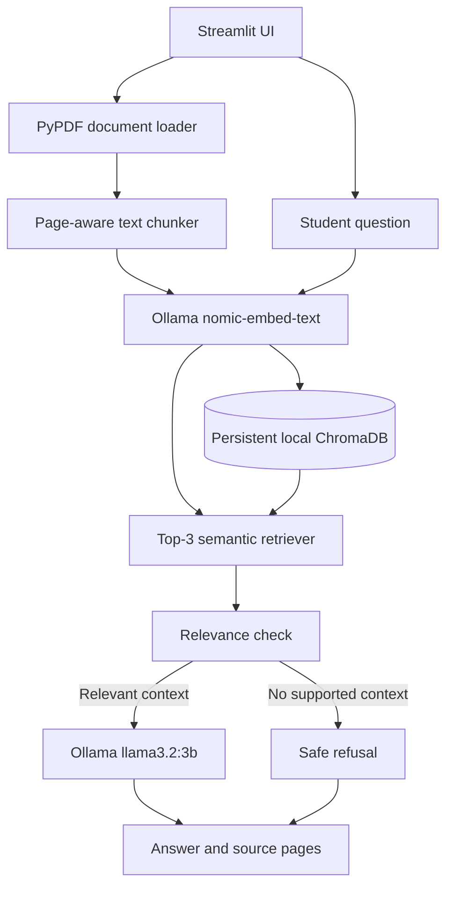

# Design and Development of a Local LLM-Based College Document Question Answering Assistant Using RAG

## Problem statement

Students often need to search several college documents to answer questions about regulations, examinations, attendance, registration, or placements. This project provides a local question-answering application that retrieves relevant passages from PDFs and asks a local language model to answer only from those passages. If the indexed documents do not support an answer, the assistant refuses rather than inventing a college policy.

The application runs on the student's computer. It uses no paid API, cloud-hosted LLM, or external database. Do not upload confidential student information. PDF files are processed locally and the persistent Chroma database stays in the ignored `chroma_db/` folder.

## Objectives and features

- Upload and index readable PDF files with their original filename and 1-based page numbers.
- Split extracted page text into 1,500-character chunks with 200-character overlap.
- Generate document and question embeddings using Ollama's `nomic-embed-text`.
- Persist embeddings, chunk text, and source metadata in local ChromaDB.
- Retrieve up to three relevant chunks and reject empty or low-relevance context before generation.
- Generate concise, context-grounded answers with Ollama's `llama3.2:3b`.
- Show supporting filenames and page numbers, list indexed documents, and remove an indexed document.
- Avoid re-indexing identical PDF bytes and show errors for invalid, empty, or image-only PDFs.
- Evaluate retrieval accuracy and safe refusals with a 50-question JSON dataset. The included sample questions refer only to a clearly fictional test fixture, not real college regulations.

Scanned/image-only PDFs are not OCR-processed. They are reported as having no extractable text.

## Technology stack

| Purpose | Technology |
| --- | --- |
| Programming language | Python 3.11 |
| Local model runtime | Ollama |
| Chat model | `llama3.2:3b` |
| Embedding model | `nomic-embed-text` |
| Local vector database | ChromaDB |
| User interface | Streamlit |
| PDF extraction | PyPDF |
| IDE | Visual Studio Code |
| Project tracking | Jira Free (separate from the application) |
| Hosting | Local computer |

Dependency versions are pinned in `requirements.txt` and were verified with Python 3.11: Streamlit 1.38.0, ChromaDB 0.5.15, PyPDF 5.1.0, Ollama Python client 0.6.3, and pytest 8.3.3.

## Architecture



## RAG workflow

1. A student uploads one or more PDFs in the Streamlit interface.
2. PyPDF extracts text page-by-page. Empty pages are skipped; source filename and page number are retained.
3. Each page's text is split into overlapping chunks.
4. Ollama creates `nomic-embed-text` vectors; ChromaDB persists vectors, chunk text, and source metadata locally.
5. A question is embedded and compared with the stored vectors. The three closest chunks are considered.
6. Empty or low-relevance results are refused before reaching the LLM.
7. Relevant chunks and their source/page labels are supplied to `llama3.2:3b` with explicit context-only instructions.
8. The answer and the retrieved sources are shown in the UI.

Prompt instructions alone cannot guarantee that a generative model never hallucinates. Retrieval-distance validation is also applied; users should verify citations against the original documents.

## Project structure

```text
student-task-manager-iac/
├── app.py
├── app_services.py
├── chunker.py
├── document_loader.py
├── embeddings.py
├── evaluate.py
├── evaluation.py
├── llm_service.py
├── models.py
├── rag_service.py
├── retriever.py
├── vector_store.py
├── requirements.txt
├── data/
│   └── sample_questions.json
├── tests/
│   ├── fixtures/
│   │   ├── fictional_demo_handbook.txt
│   │   └── fictional_demo_handbook.pdf
│   ├── conftest.py
│   ├── test_chunker.py
│   ├── test_document_loader.py
│   ├── test_embeddings.py
│   ├── test_evaluation.py
│   ├── test_rag_service.py
│   └── test_vector_store.py
├── chroma_db/                 # Created locally; ignored by Git
├── .streamlit/
│   └── config.toml            # Binds Streamlit to localhost only
└── README.md
```

The original Student Task Manager frontend, Worker API, Terraform configuration, Wrangler configuration, Node manifests, and Cloudflare GitHub Actions deployment have been removed because they are not part of this local Python project.

## Requirements

- Windows 10/11, Python 3.11, and Visual Studio Code.
- Ollama installed and running locally.
- Enough disk space and memory for the two local models. Model size and generation speed depend on the computer.
- No Cloudflare account, Terraform, GitHub Actions, API token, or paid service is needed.

## Windows installation and execution

Open the project folder in VS Code, then open a PowerShell terminal in that folder.

1. Install Python 3.11 from [python.org](https://www.python.org/downloads/) and select **Add Python to PATH**.
2. Install Ollama from [ollama.com](https://ollama.com/download).
3. Pull the required local models:

   ```powershell
   ollama pull llama3.2:3b
   ollama pull nomic-embed-text
   ```

4. Create and activate the Python environment:

   ```powershell
   python -m venv venv
   .\venv\Scripts\Activate.ps1
   ```

5. Install Python dependencies:

   ```powershell
   pip install -r requirements.txt
   ```

6. Ensure Ollama is running. The Ollama desktop application normally starts its local service automatically. If needed, open another terminal and run:

   ```powershell
   ollama serve
   ```

7. Start Streamlit from the project directory:

   ```powershell
   streamlit run app.py
   ```

8. Open the local URL Streamlit prints (normally `http://localhost:8501`), upload readable college PDFs, select **Index uploaded PDFs**, then enter a question and select **Ask**.

Ollama's local HTTP endpoint defaults to `http://localhost:11434`. To use another local Ollama endpoint, set `OLLAMA_HOST` before starting Streamlit; no API key is used.

## Tests and evaluation

Run the automated unit tests:

```powershell
python -m pytest
```

The tests use fake Ollama responses and temporary Chroma databases, so they do not require downloaded models or a running Ollama server. They cover PDF extraction (including empty and invalid PDFs), chunk boundaries, embedding calls/errors, Chroma persistence and metadata, retrieval distance filtering, and safe refusal when context is absent.

`data/sample_questions.json` contains 50 questions: 20 direct, 20 paraphrased, and 10 unanswerable. **All answerable sample facts refer to `tests/fixtures/fictional_demo_handbook.pdf`, a fictional testing fixture; they are not real college rules.** To run the question-set evaluation with the supplied fixture, keep Ollama running, upload and index that PDF in the app, then run:

```powershell
python evaluate.py
```

The script compares each retrieved source with the dataset's expected fixture source and reports retrieval accuracy using the official definition `correct retrievals / total questions × 100`. For an unanswerable question, retrieval is counted as correct only when no sufficiently relevant passage is returned. It reports safe refusal rate as `correct refusals / unanswerable questions × 100`. It writes per-question retrieval and refusal outcomes to `evaluation_results.csv`; the results file is ignored by Git. Fill in the CSV's human-rating columns (1–5) for correctness, relevance, groundedness, clarity, and completeness after reviewing each answer and its source. Those ratings require human judgment; they are not automated scores.

The fixture PDF can be selected directly from `tests/fixtures/fictional_demo_handbook.pdf`. It is a test aid only and must not be presented as an official college document. For evaluation against real documents, replace the fixture source/expected answers with approved college material and keep the expected source filenames aligned with the uploaded PDFs.

## Jira project management guide

Jira is a project tracking tool only; the application has no Jira integration.

1. Create a Jira Free **Scrum** project named **College RAG Assistant** with project key **RAG**.
2. Configure the board workflow as **TO DO → IN PROGRESS → CODE REVIEW → TESTING → DONE**.
3. Create six epics:
   - EPIC-1: Requirements and Dataset
   - EPIC-2: Local LLM Setup
   - EPIC-3: RAG Pipeline
   - EPIC-4: User Interface
   - EPIC-5: Testing and Evaluation
   - EPIC-6: Documentation and Demonstration
4. Enter the following initial product backlog (story points from the official project document):

| Issue | Backlog item | Type | Epic | Points |
| --- | --- | --- | --- | ---: |
| RAG-1 | Define functional requirements | Story | EPIC-1 | 3 |
| RAG-2 | Collect college documents | Task | EPIC-1 | 3 |
| RAG-3 | Prepare 50 sample questions | Task | EPIC-1 | 5 |
| RAG-4 | Install Ollama | Task | EPIC-2 | 2 |
| RAG-5 | Run and test local LLM | Task | EPIC-2 | 3 |
| RAG-6 | Develop PDF text extractor | Story | EPIC-3 | 3 |
| RAG-7 | Develop text chunking module | Story | EPIC-3 | 3 |
| RAG-8 | Generate embeddings | Story | EPIC-3 | 5 |
| RAG-9 | Create vector database | Story | EPIC-3 | 5 |
| RAG-10 | Develop semantic retrieval | Story | EPIC-3 | 5 |
| RAG-11 | Integrate retrieved context with LLM | Story | EPIC-3 | 5 |
| RAG-12 | Develop RAG prompt | Story | EPIC-3 | 3 |
| RAG-13 | Implement source citation | Story | EPIC-3 | 3 |
| RAG-14 | Implement unknown-answer handling | Story | EPIC-3 | 3 |
| RAG-15 | Create Streamlit UI | Story | EPIC-4 | 5 |
| RAG-16 | Display retrieved sources | Story | EPIC-4 | 3 |
| RAG-17 | Perform functional testing | Task | EPIC-5 | 5 |
| RAG-18 | Evaluate LLM responses | Task | EPIC-5 | 5 |
| RAG-19 | Fix identified defects | Bug/Task | EPIC-5 | 5 |
| RAG-20 | Prepare documentation and demo | Task | EPIC-6 | 5 |

5. Create four one-week sprints:
   - **Sprint 1 — Foundation:** RAG-1 to RAG-5. Goal: requirements, dataset, Ollama/model setup.
   - **Sprint 2 — RAG Development:** RAG-6 to RAG-10. Goal: extraction, chunking, embeddings, vector storage, retrieval.
   - **Sprint 3 — Complete LLM Application:** RAG-11 to RAG-16. Goal: prompt, citations, refusal, UI.
   - **Sprint 4 — Testing and Submission:** RAG-17 to RAG-20. Goal: functional testing, human evaluation, bug fixes, documentation/demo.
6. During each sprint, move issues through the workflow, record test defects as bugs (including reproduction steps), assign owners, and review completed work. Jira status is maintained by the student team and is not synchronized with application state.

## Known limitations and troubleshooting

- **Ollama connection error:** Start the Ollama desktop app or `ollama serve`, then verify `ollama list` includes both model names.
- **Model missing:** Run the two `ollama pull` commands above.
- **No readable PDF text:** Image-only/scanned documents are not supported because OCR is not implemented. Use a text-based PDF.
- **No answer / refusal:** Check that the right document is indexed and that its text includes evidence for the question. Short or ambiguous PDFs may not retrieve confidently.
- **Chroma data reset:** Stop Streamlit, then delete the local `chroma_db/` folder only if you intentionally want to rebuild the index. The folder is local and ignored by Git.
- **Slow responses:** Local inference speed depends on available memory and CPU/GPU. The app uses the required `llama3.2:3b` model.
- **No college documents are bundled:** Use approved, non-confidential documents supplied by your college. The included text fixture is fictional and for evaluation/testing only.
- Generated answers can still be imperfect. Check the displayed source passages and confirm important policies with official college sources.
